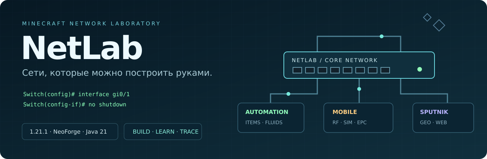

<div align="center">



**Собери сеть. Настрой оборудование. Проследи путь каждого пакета.**

Minecraft **1.21.1** · NeoForge **21.1.265** · Java **21** · **Alpha**

[Документация](docs/README.md) · [Первая лабораторная](docs/LAB-01.md) · [Поддержанные команды](docs/COMMAND-AUDIT.md)

</div>

NetLab превращает Minecraft в учебную сетевую лабораторию. Устанавливай оборудование в шкафы, прокладывай кабели по стенам, подключайся к консоли и настраивай сеть через IOS-подобные команды. Надень инженерные очки, чтобы увидеть порты и движение пакетов прямо в мире.

Это независимый учебный симулятор: Cisco IOS и образы операционных систем в комплект не входят. Поддержка команд и границы моделирования описаны в [аудите CLI](docs/COMMAND-AUDIT.md).

## Готовые JAR — скачать и положить в mods

**[Открыть папку mods с четырьмя готовыми модами](mods/)** — JAR хранятся прямо в Git, сборка исходников не требуется. Один комплект используется на **Windows 10/11 x64 и Linux x64**. В этой папке только моды NetLab; сторонние библиотеки, лаунчеры и Chromium в неё не включены.

| Готовый файл | Скачать |
|---|---|
| NetLab 0.21.2 | [netlab-0.21.2-alpha.jar](https://raw.githubusercontent.com/G8Dman/NetLab/main/mods/netlab-0.21.2-alpha.jar) |
| Automation 0.7.3 | [netlab-automation-0.7.3-alpha.jar](https://raw.githubusercontent.com/G8Dman/NetLab/main/mods/netlab-automation-0.7.3-alpha.jar) |
| Mobile 0.3.2 | [netlab-mobile-0.3.2-alpha.jar](https://raw.githubusercontent.com/G8Dman/NetLab/main/mods/netlab-mobile-0.3.2-alpha.jar) |
| Sputnik 0.2.2 | [netlab-sputnik-0.2.2-alpha.jar](https://raw.githubusercontent.com/G8Dman/NetLab/main/mods/netlab-sputnik-0.2.2-alpha.jar) |

**Скачивание открыто всем без регистрации и входа.** Ссылки выше скачивают JAR непосредственно. [Скачать все четыре мода одним ZIP](https://github.com/G8Dman/NetLab/releases/download/netlab-suite-0.21.2/NetLab-1.21.1-mods.zip).

В сборках с AE2 можно [отключить только его автоматизацию](docs/UPDATE-AUTOMATION-0.7.3.md), сохранив ручное ME-хранилище. [Пример серверной конфигурации](config-examples/netlabautomation-server.toml); по умолчанию ограничение выключено.

Контрольные суммы: [SHA256SUMS.txt](SHA256SUMS.txt). Состав комплекта и зависимости: [MODS.json](MODS.json).

### Обязательные сторонние зависимости

| Что установить отдельно | Для чего | Где нужно |
|---|---|---|
| **Minecraft 1.21.1, NeoForge 21.1.265, полная Java 21** | Все моды NetLab | Клиент и сервер |
| **[Rinku 3.0.4, NeoForge 1.21.1](https://modrinth.com/mod/rinku/version/JOrwMXrE)** | Chromium-браузер дополнения Sputnik | Только клиент со Sputnik |

Rinku сам скачивает Chromium под текущую ОС при первом запуске; для этого нужен интернет. Отдельно ставить Chrome/Chromium в систему не требуется. Если Sputnik не установлен, Rinku не нужен. Для Automation и Mobile дополнительных библиотечных модов не требуется. JEI, Sodium и Iris не являются зависимостями NetLab.

## Четыре мода — одна лаборатория

| Мод | Версия | Что добавляет |
|---|---|---|
| **NetLab** | `0.21.2-alpha` | Коммутаторы, маршрутизаторы, ПК, ноутбуки, Wi-Fi, физические порты, питание, CLI и наблюдение за пакетами. |
| **NetLab Automation** | `0.7.3-alpha` | Сетевую передачу предметов и жидкостей, сервер автоматизации, правила, рецепты, нагрев и охлаждение; необязательный запрет автоматизации AE2 с сохранением ручного ME-хранилища. |
| **NetLab Mobile** | `0.3.2-alpha` | Сотовую сеть: антенны на башнях игроков, RRU, BBU, ядро EPC, выпуск SIM и модемы для ПК/ноутбука. |
| **NetLab Sputnik** | `0.2.2-alpha` | Спутниковую сеть: HUB, BUC/LNB, VSAT, интернет-шлюз, браузер настоящих сайтов и колонки с фоновым звуком. |

Версии дополнений из этого комплекта требуют основной **NetLab 0.21.0-alpha или новее**. Они устанавливаются независимо друг от друга.

Обновление **0.21.2**: декоративный блок «Вкусно и точка» теперь крафтится из одного блока цискиума, оранжевого и красного красителей и хлеба в любом порядке.

Обновление **0.21.1**: [перенос шкафов через Carry On и стиль MineColonies «Вкусно и точка»](docs/UPDATE-0.21.1.md). Carry On, MineColonies и Structurize — необязательные сторонние моды; они не включены в JAR NetLab. Стиль уже входит в основной мод.

Для этих двух возможностей проверены Carry On `2.2.6.13`, MineColonies `1.1.1414` и Structurize `1.0.838` для Minecraft 1.21.1. MineColonies также требует BlockUI, Domum Ornamentum и Multi-Piston — [инструкция и зависимости MineColonies](https://minecolonies.com/wiki/installation/). Все эти моды ставятся отдельно; для остальных функций NetLab они не нужны. [Отдельный ZIP стиля «Вкусно и точка»](https://github.com/G8Dman/NetLab/releases/download/netlab-suite-0.21.2/NetLab-Vkusno-i-Tochka-MineColonies.zip) предназначен для ручной установки без NetLab; при установленном NetLab распаковывать его не требуется.

Обновление **0.21.0**: [крафт, расход и возврат кабелей](docs/UPDATE-0.21.0.md).

## NetLab · от разъёма до маршрута

- **Физическое оборудование.** Шкаф с двумя ячейками, сменные платы, передняя панель, отдельный Console и индикация портов. Отвёртка снимает оборудование по Shift+ПКМ.
- **Кабели, которые видно.** Медь, оптика, serial, консольные кабели и питание с прокладкой по поверхностям, окраской и именами.
- **Настройка внутри модели.** Режимы CLI, сокращения, Tab, VLAN, trunk, STP, EtherChannel, IPv4/IPv6, маршрутизация и поддержанные сетевые службы.
- **Консольный доступ.** ПК/ноутбук подключается RS232 → Console. Портативный терминал открывает консоль через разъём; настройки устройства сохраняются, история его сеанса очищается.
- **Учебная симуляция.** Очки показывают путь пакетов. Контроллер трафика регулирует скорость по LAN, VLAN и протоколу с разграничением прав.
- **Инфраструктура.** FE-питание, энергошкаф, блок питания шкафа, карты памяти CISCO и производство на основе цискиума.
- **Справочник в игре.** «Библия по CISCO» объясняет блоки и команды; дополнения добавляют свои разделы.

[Модули и кабели](docs/MODULES-AND-CABLES.md) · [Коммутация](docs/STUDY-AND-SWITCHING.md) · [Маршрутизация](docs/ROUTER-COMMANDS.md) · [Питание](docs/POWER-AND-PORTABLE.md)

## Automation · предметы и жидкости по сети

Мультиинтерфейсы читают поддержанные инвентари и резервуары через возможности NeoForge. Сервер обрабатывает запросы, а приложение на ПК/ноутбуке позволяет выбирать источник, получателя, предмет и количество, просматривать слоты, создавать правила запаса и шаблоны изготовления.

Передача проходит по настроенному сетевому маршруту. Предметы и жидкости учитываются в журнале билетов; повторный запрос не должен создавать второй груз. Незащищённую передачу можно перехватить в рамках игровой механики, поэтому шифрование настраивается на маршрутизаторе. Ускорители увеличивают нагрузку и нагрев сервера: для стабильной работы нужны питание и охлаждение.

Совместимость зависит от того, какие возможности и стороны доступа предоставляет подключённый блок. Шаблоны изготовления не являются полным аналогом рекурсивного автокрафта AE2.

[Начальная настройка](docs/AUTOMATION.md) · [Жидкости](docs/FLUID-TRANSFERS.md) · [Пакеты предметов](docs/ITEM-PACKETS.md) · [Охлаждение](docs/SERVER-COOLING.md)

## Mobile · собственный сотовый оператор

Построй башню из любых подходящих блоков, закрепи двухблочную антенну, подключи её к RRU, проложи оптический fronthaul до BBU и транспортную сеть до EPC. Станок регистрирует SIM в ядре оператора, а мобильный модуль подключает ПК или ноутбук к сети.

Радиоканал учитывает высоту, расстояние, направление, препятствия и помехи. Пропускная способность разделяется между абонентами. Cisco Pocket показывает сигнал и регистрацию, а сменные модули добавляют диагностику, браузер Sputnik и управление автоматикой. Оборудование, платы, кабели и заготовки SIM имеют рецепты. Зарегистрированные SIM выпускаются станком.

[Антенны, оборудование, SIM и настройка оператора](docs/NETLAB-MOBILE.md)

## Sputnik · интернет через спутник

Собери станцию провайдера с HUB и интернет-шлюзом, настрой антенны и зарегистрируй абонентский VSAT-модем. Браузер открывает реальные сайты через интернет Minecraft-сервера и настроенный путь NetLab. Подключённые колонки позволяют оставить музыку играть в фоне и слышать её поблизости.

Первая версия моделирует фиксированные GEO-спутники, задержку, общую ёмкость канала и качество сигнала. Браузер работает с одной вкладкой; совместимость с DRM и любым медиасервисом не гарантируется. Оборудование, платы и кабели имеют рецепты верстака.

[Спутниковая станция, браузер и звук](docs/NETLAB-SPUTNIK.md)

## Установка

1. Подготовь **Minecraft 1.21.1 / NeoForge 21.1.265 / Java 21**.
2. Скачай JAR прямо из [папки mods](mods/) или из **Релизы / Releases**. Положи основной NetLab и нужные дополнения в папку `mods/` своей сборки. Удали старые версии тех же модов.
3. Для **Sputnik** дополнительно установи на клиент [Rinku 3.0.4 для NeoForge 1.21.1](https://modrinth.com/mod/rinku). При первом использовании Rinku подготавливает Chromium. На выделенный сервер Rinku не нужен.
4. Для совместной игры установи одинаковые версии выбранных модов на сервер и клиенты.

| Компонент | Клиент | Сервер |
|---|---|---|
| NetLab | Да | Да |
| Выбранные дополнения NetLab | Да | Да |
| Rinku для Sputnik | Да | Нет |

Сторонние моды хранения, труб или энергии для базовой работы Automation не обязательны. Creative-генератор NetLab позволяет запитать учебный стенд.

## Первый стенд

С правами оператора выполни нужную команду на свободном месте. Демо проверяет область строительства и отказывается заменять существующие блоки.

| Команда | Результат |
|---|---|
| `/netlab demo` | Настроенная сеть для первого ping. |
| `/netlab demo automation` | Передача из сундука в сундук и книга команд. Требует Automation. |
| `/netlab mobile kit` | Оборудование для самостоятельной сотовой сети. Требует Mobile. |
| `/netlab demo sputnik` | Стенд провайдера и абонента с ноутбуком и колонкой. Требует Sputnik. |
| `/netlab sputnik kit` | Ненастроенное спутниковое оборудование. Требует Sputnik. |
| `/netlab study` | Настройки учебной симуляции. |

Для ручной настройки начни с [лабораторной с двумя подсетями](docs/LAB-01.md). Для сохранения конфигурации инфраструктуры установи **карту памяти CISCO**; у ПК и ноутбука память встроена.

## Сборка из исходников

Нужны **JDK 21**, **Python 3** и доступ к репозиториям зависимостей при первой сборке.

```bash
./dev.sh build
```

Скрипт получает проверенный по SHA-512 API Rinku, выбирает Java 21 и запускает Gradle Wrapper. Команда собирает все четыре JAR в `build/libs/` и выполняет проверки ядра. **Minecraft, сервер, мир и GameTest при этой сборке не запускаются.** Отдельная проверка модели: `./dev.sh coreTest`.

На Windows из CMD: `dev.cmd build`. Чтобы обновить готовые файлы в Git после сборки: `python tools/package_mods.py`.

```text
src/main/        основной NetLab
src/automation/  дополнение Automation
src/mobile/      дополнение Mobile
src/sputnik/     дополнение Sputnik
src/coreTest/    проверки модели без запуска игры
docs/           инструкции и отчёты о проверках
tools/          генераторы ресурсов и вспомогательные проверки
```

## Статус разработки

Проект находится в alpha: поведение сети и набор поддержанных команд развиваются. Проверки ядра и отдельных runtime-компонентов не заменяют проверку интерфейсов и совместимости в игре. Подробнее: [аудит команд](docs/COMMAND-AUDIT.md), [проверки Mobile](docs/MOBILE-VALIDATION.md), [проверки Sputnik](docs/SPUTNIK-VALIDATION.json).

При сообщении об ошибке укажи версии установленных модов, схему соединений, настройки IP/VLAN/портов и шаги воспроизведения. Удали пароли и токены из прикладываемых логов.

Лицензия модов в метаданных: **All Rights Reserved**. Уведомление исходного шаблона NeoForge MDK сохранено в [TEMPLATE_LICENSE.txt](TEMPLATE_LICENSE.txt).

## Cisco Pocket: телефон как сетевой клиент

Для телефона NetLab Mobile доступны четыре физических модуля:

| Модуль | Какое дополнение добавляет | Возможности |
|---|---|---|
| Терминал Cisco Pocket | Mobile | Локальная Console без SIM; история трёх последних устройств |
| Диагностика Cisco Pocket | Mobile | Ping игровых IP, UDP/TCP-пакеты с полезной нагрузкой и наблюдение пути в очках |
| Браузер Cisco Pocket | Sputnik | Реальные сайты через мобильную сеть и интернет-шлюз провайдера; нужен Rinku на клиенте |
| Автоматика Cisco Pocket | Automation | Работа с привязанным сервером: интерфейсы, предметы, жидкости, правила и рецепты |

Модуль автоматики сначала привязывается ПКМ по своему настроенному серверу. Затем телефон → «Модули» → установить предмет из инвентаря. Пароль сервера вводится при входе в приложение и на модуле не хранится. Привязка проверяет физический ID сервера и измерение.

Телефон получает IP от EPC и передаёт данные через действующие LTE-очереди. Потеря SIM, радиосвязи или нужного модуля прекращает доступ. Браузерный модуль принадлежит Sputnik; без Mobile он не превращается в отдельный телефон. Обычные приложения ПК/ноутбука сохраняются.

[Пошаговая настройка Sputnik по каждому устройству и адресации](docs/NETLAB-SPUTNIK.md) доступна также в игровой «Библии по CISCO».

## Шуточный ресурспак

Cisco Sky подготовлен отдельно от модов: [страница ресурспака](https://github.com/G8Dman/NetLab-Cisco-Sky). В его репозитории находятся готовый ZIP, исходные файлы и инструкция установки. Ресурспак не требует NetLab или NeoForge.

Ноутбук работает от аккумулятора 48 000 FE (20 минут при 20 TPS), заряжается через задний DC / FE и сохраняет настройки, модули и заряд в выпавшем предмете. [Как заряжать и переносить](docs/POWER-AND-PORTABLE.md).

Кабели складываются по 64; в выживании одно соединение расходует один предмет, при отключении он возвращается. Shift+ПКМ по занятому порту работает также пустой рукой. Все 15 типов имеют крафт; [инструкция и список](docs/CABLES-CRAFTING.md).
